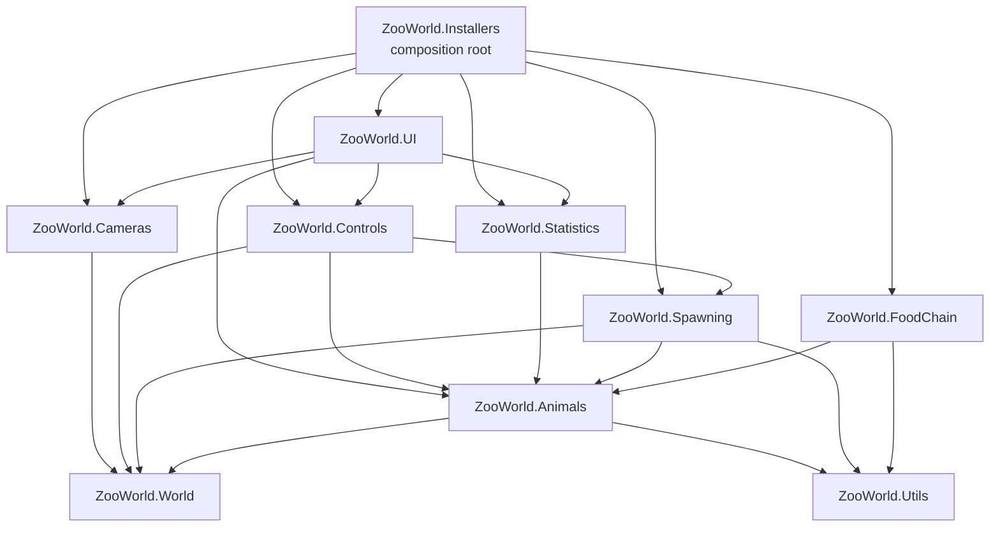
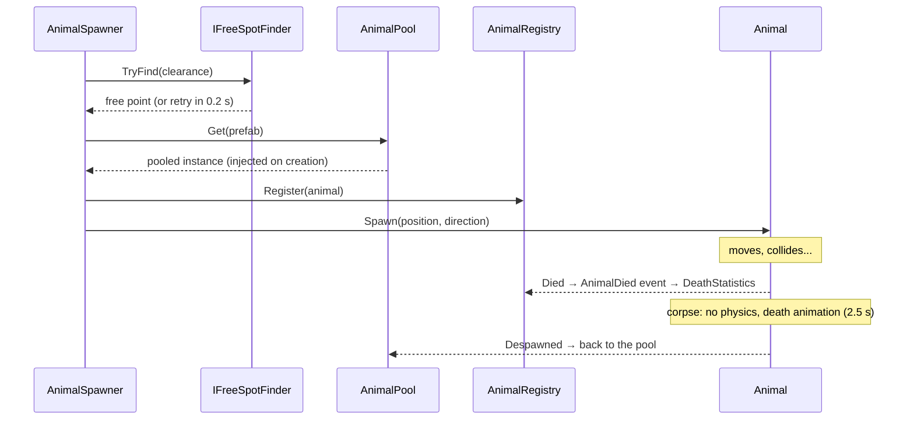
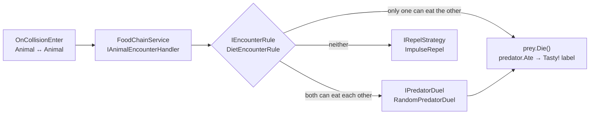

# Zoo World

A small top-down 3D simulation in Unity: animals appear every 1–2 seconds, roam the screen, bounce off obstacles and each other, and eat each other according to a data-driven food chain.

The main goal of the project is the **animal architecture**: adding a new species (birds, spiders, fish, crabs…) should take a prefab and a few assets, not changes to existing code.


---

## Contents

- [Getting started](#getting-started)
- [Gameplay](#gameplay)
- [Architecture](#architecture)
  - [Principles](#principles)
  - [Modules and assemblies](#modules-and-assemblies)
  - [Composition root](#composition-root)
  - [Animal anatomy](#animal-anatomy)
  - [Life of an animal](#life-of-an-animal)
  - [Encounters and the food chain](#encounters-and-the-food-chain)
  - [Staying on screen and obstacles](#staying-on-screen-and-obstacles)
  - [UI](#ui)
- [Extending the zoo](#extending-the-zoo)
- [Configuration](#configuration)
- [Testing](#testing)
- [Editor tools](#editor-tools)
- [Project structure](#project-structure)
- [Design decisions](#design-decisions)

---

## Getting started

**Requirements:** Unity **6000.3.27f1** (Unity 6.3 LTS). Git must be installed: VContainer is pulled from its Git repository by the Package Manager.

1. Clone the repository and open the folder in Unity Hub.
2. Open `Assets/_Project/Scenes/Zoo.unity`.
3. Press **Play**.

No input is needed; the simulation runs on its own.

### Packages

| Package | Why |
|---|---|
| [VContainer](https://github.com/hadashiA/VContainer) 1.19.0 | Dependency injection, entry points (`IStartable`, `ITickable`) |
| Universal Render Pipeline | Rendering |
| uGUI + TextMeshPro | HUD and world-space labels |
| Test Framework | Edit-mode unit tests |

---

## Gameplay

| | |
|---|---|
| **Camera** | Orthographic, top-down. The visible ground is the play area. |
| **Spawning** | Every 1–2 s a random animal from the catalog appears at a **free** spot (no animal or obstacle nearby) and starts moving in a random direction. |
| **Screen edges** | An animal that reaches the edge of the screen turns back; it never leaves the screen, even when pushed or mid-jump. |
| **Obstacles** | 5–8 random trees and rocks are placed at start. Animals bounce off them and change direction. |
| **Frog** (prey) | Every 1.5 s jumps a fixed distance (2 m) in a new random direction. Animated: stands while on the ground, plays its run animation while moving. |
| **Snake** (predator) | Moves in a straight line at a constant speed (2 m/s), playing a looping crawl animation. |
| **Prey + prey** | They are pushed apart by physics; both survive. |
| **Predator + prey** | The prey dies: it stops, plays its death (the frog's death animation), stays on the ground for a moment, then disappears. |
| **Predator + predator** | One random survivor eats the other. A dead snake freezes in its static pose and rolls belly-up. |
| **"Tasty!"** | Appears under a predator every time it eats, and the predator is outlined for about a second. |
| **HUD** | Top-right counter of dead prey and dead predators (uGUI). |
| **Control panel** | Bottom-of-screen tools bar that also works in builds: spawn animals, force encounters, rebuild obstacles, kill animals, change game speed, and see live info. See [In-game control panel](#in-game-control-panel). |

---

## Architecture

### Principles

- **Composition over inheritance.** An animal is a prefab assembled from components: `Animal` (lifecycle), a movement component, optional extras such as the `TastyLabel`. There is no class per species.
- **Data in ScriptableObjects.** Everything that describes a species (name, role, diet) lives in an `AnimalConfig` asset. Which animals spawn and how often lives in an `AnimalCatalog` asset.
- **Dependency injection.** Services are plain C# classes behind interfaces, wired in one place (`GameLifetimeScope`). MonoBehaviours receive what they need through `[Inject]` methods; nothing uses singletons or `FindObjectOfType` at runtime.
- **Animals report, services decide.** An animal only says "I collided with that animal". What it means (eat, duel, bounce) is decided by the food chain module. Animals know nothing about the rules.
- **Strategy everywhere it may change.** Movement, encounter rule, predator duel and repel reaction are interfaces with one implementation each, swappable in one line.
- **Prefab-based.** Animals, obstacles, the HUD and the "Tasty!" label are prefabs edited in the Editor; code only instantiates them (pooled for animals).
- **No ECS**, as required.

### Modules and assemblies

Each folder under `Assets/_Project/Scripts` is its own assembly definition, so the compiler enforces the dependency direction (e.g. `Animals` cannot reference `FoodChain` or `UI`).



| Assembly | Responsibility | Key types |
|---|---|---|
| `ZooWorld.Utils` | Small math helpers on the ground plane | `GroundDirection` |
| `ZooWorld.World` | The space animals live in | `IPlayArea` / `CameraPlayArea`, `IFreeSpotFinder` / `PhysicsFreeSpotFinder`, `Obstacle` |
| `ZooWorld.Animals` | What an animal is and how it moves | `Animal`, `AnimalConfig`, `AnimalMovement`, `JumpMovement`, `LinearMovement`, `IAnimalRegistry` |
| `ZooWorld.FoodChain` | Who eats whom and what happens on contact | `DietEncounterRule`, `RandomPredatorDuel`, `ImpulseRepel`, `FoodChainService` |
| `ZooWorld.Spawning` | Creating animals and obstacles | `AnimalSpawner`, `AnimalPool`, `AnimalCatalog`, `ObstacleSpawner` |
| `ZooWorld.Statistics` | Counting deaths | `DeathStatistics` |
| `ZooWorld.Controls` | Player-facing actions on the running zoo, shared by the in-game panel and the editor window | `IZooCommands` / `ZooCommands`, `EncounterForecast`, `CameraAnimalPicker` |
| `ZooWorld.Cameras` | Static/free camera switching and free camera input | `CameraSwitcher`, `FreeCameraController`, `ScreenUiHitTest` |
| `ZooWorld.UI` | HUD, labels, control panel | `DeathCounterView`/`Presenter`, `TastyLabel`, `ControlPanelView`/`Presenter`, `CameraViewportReservation` |
| `ZooWorld.Installers` | Wiring everything together | `GameLifetimeScope` |
| `ZooWorld.Editor` | Editor-only tools (not in builds) | `ZooDebugWindow`, `ZooTestsMenu` |

### Composition root

`GameLifetimeScope` (a VContainer `LifetimeScope` on the `GameLifetimeScope` object in the scene) is the only place that knows which implementation stands behind each interface. All tuning values are serialized on it and edited in the Inspector.

```csharp
// World
builder.Register<IPlayArea, CameraPlayArea>(Lifetime.Singleton);
builder.Register<IFreeSpotFinder, PhysicsFreeSpotFinder>(Lifetime.Singleton);

// Food chain
builder.Register<IPredatorDuel, RandomPredatorDuel>(Lifetime.Singleton);
builder.Register<IEncounterRule, DietEncounterRule>(Lifetime.Singleton);
builder.Register<IRepelStrategy, ImpulseRepel>(Lifetime.Singleton);
builder.Register<FoodChainService>(Lifetime.Singleton).AsImplementedInterfaces();

// Spawning
builder.RegisterEntryPoint<ObstacleSpawner>().WithParameter(_obstaclesRoot).AsSelf();
builder.Register<AnimalRegistry>(Lifetime.Singleton).AsImplementedInterfaces();
builder.Register<AnimalPool>(Lifetime.Singleton).WithParameter(_animalsRoot).AsImplementedInterfaces();
builder.RegisterEntryPoint<AnimalSpawner>().As<IAnimalSpawner>();

// UI
builder.RegisterEntryPoint<DeathStatistics>().As<IDeathStatistics>();
builder.RegisterComponent(_deathCounterView);
builder.RegisterEntryPoint<DeathCounterPresenter>();
```

### Animal anatomy

```
Snake (prefab, layer "Animal")
├── Rigidbody             physics body, rotation frozen
├── CapsuleCollider
├── LinearMovement        ← how it moves (an AnimalMovement)
├── Animal                ← lifecycle, collisions, events; references SnakeConfig
├── AnimalAnimator        ← feeds the Animator (Speed, Die)
├── FlipOnDeath           ← rolls the model belly-up when it dies
├── OutlineOnEat          ← outlines the model for 1 s after it eats
├── Model                 nested FBX with an Animator (Snake.controller); visuals only
└── TastyLabel            nested prefab, shows "Tasty!" when this animal eats
```

| Piece | Kind | Role |
|---|---|---|
| `AnimalConfig` | ScriptableObject | Species data: display name, `Role` (prey/predator, used for statistics), **`Diet`** (species it eats). |
| `Animal` | MonoBehaviour | Lifecycle `Spawn` → alive → `Die` → corpse → `Despawn`; events `Spawned`, `Died`, `Despawned`, `Ate`; `Push`; reports collisions with other animals to `IAnimalEncounterHandler`. |
| `AnimalAnimator` | MonoBehaviour | Same for every species: sets the Animator's `Speed` float from the body's horizontal speed and fires the `Die` trigger. Each species' Animator Controller decides what that looks like. |
| `FlipOnDeath` | MonoBehaviour | Optional: for animals without a death clip, rolls the model belly-up with a small hop; restored on respawn. |
| `OutlineOnEat` | MonoBehaviour | Optional: on `Ate`, adds the outline material (`ZooWorld/Outline`, an inverted-hull URP shader) to the model's renderers for 1 s and animates its width with a MaterialPropertyBlock, so no material copies are created. |
| `AnimalMovement` | Abstract MonoBehaviour | Base for all movement types. Handles staying on screen and bouncing off obstacles for every subclass. A subclass only implements `Move(deltaTime)`. |
| `JumpMovement` | `AnimalMovement` | Periodic jumps of a fixed distance; launch speed is computed from distance, angle and gravity. Aims each jump so it lands on screen. |
| `LinearMovement` | `AnimalMovement` | Constant speed in a straight line. |

### Life of an animal



- **Death is a state, not an instant removal.** `Die()` marks the animal dead (it is counted right away and can no longer be eaten), stops its movement and turns its body into a corpse: colliders off, Rigidbody kinematic, so it neither blocks other animals nor spawning. Presentation components react to `Died` (death clip, flip). After the corpse duration the animal raises `Despawned`.
- **`AnimalPool`** keeps one `ObjectPool<Animal>` per prefab. Instances are created through the container (`IObjectResolver.Instantiate`), so their `[Inject]` methods are called, and they return to their pool on `Despawned`.
- **`AnimalRegistry`** is the single source of truth about living animals, whatever spawned or killed them. It drives the alive-animals limit and the death statistics.

### Encounters and the food chain



- Both animals receive `OnCollisionEnter`; only the one with the lower instance id reports it, so every collision is handled once.
- **Who eats whom is data, not code.** `DietEncounterRule` checks each species' `Diet`:
  - `SnakeConfig.Diet = [Frog, Snake]`: snakes eat frogs and fight other snakes.
  - `FrogConfig.Diet = []`: frogs eat nothing.
  - A bird that eats spiders but not crabs is just `BirdConfig.Diet = [Spider]`.
- `AnimalRole` (Prey / Predator) does not affect the rules; it only decides which counter a death goes to.

### Staying on screen and obstacles

- **`CameraPlayArea`** projects the camera's viewport onto the ground plane (and recalculates when the screen size changes), shrunk by a padding so whole bodies stay visible.
- Every physics step, `AnimalMovement` mirrors the **direction and the actual velocity** on any axis where the animal is outside the area and still moving away. Pushes, collisions and jumps therefore cannot carry an animal off screen.
- `JumpMovement` also checks the **landing point** before jumping and turns the jump back if it would land outside.
- **Obstacles** (trees and rocks built from simple shapes) are prefabs with an `Obstacle` component on the `Obstacle` layer. Trees collide with one capsule around the trunk, so animals can slip under the edge of the canopy. Rocks are groups of massive, softly deformed ovals: three lumpy boulder meshes (`Art/Rocks/RockMesh_*`, generated once in the editor from a sphere bent by a few broad random waves, with a flattened base), each with a matching 100-triangle convex collision mesh (`RockCollision_*`). On contact, `AnimalMovement` reflects its direction off the contact normal (`GroundDirection.Deflect`); a frog then jumps away from the obstacle instead of in a random direction.
- **`PhysicsFreeSpotFinder`** tries random points and keeps the first one with no collider on the `Animal` / `Obstacle` layers within the requested clearance, keeping that clearance inside the screen too. It is used both for spawning animals (no spawning on top of another animal) and for placing obstacles (no overlaps, nothing half off-screen).

### UI

- **Dead counter (MVP):** `DeathStatistics` (model) counts `AnimalRegistry.AnimalDied` events by role → `DeathCounterPresenter` → `DeathCounterView` (two TextMeshPro labels in `Hud.prefab`, anchored top-right). The view knows nothing about the game.
- **"Tasty!" label:** `TastyLabel.prefab` is a world-space canvas nested in the Snake prefab. It listens to its own animal's `Ate` event, pops up under the animal (in screen terms), faces the camera, and fades out. Any future predator gets it by nesting the same prefab.

### In-game control panel

A tools bar at the bottom of the screen (part of `Hud.prefab`) that works in builds too:

| Section | Controls |
|---|---|
| Header | Status line with the result of the last action, and an **arrow** that slides the panel down (only the header stays) or back up. **Swiping** down or up anywhere on the panel does the same, with a mouse or a finger. |
| Spawning | Pause/resume automatic spawning, one **+ species** button per catalog entry, **+ 10 random** |
| Force an encounter | Two species dropdowns, the expected outcome from their diets, **Push them together** |
| World | **New obstacles** (new random layout), **Kill on click** toggle (while on, clicking or tapping an animal kills it), **Kill all** |
| Camera | **Camera: Static / Free** switch, **Zoom − / Zoom +**, **Reset view**, and a hint with the controls |
| Simulation | Game speed slider (0–5×), live info: alive per species, dead prey/predators, obstacles, spawning state |

- **MVP again:** `ControlPanelView` is a passive set of uGUI widgets that raises events. `ControlPanelPresenter` (a VContainer entry point) turns them into calls on `IZooCommands` and refreshes the info 4 times per second in real time, so it keeps updating while the game is paused. The per-species buttons are instances of `SpeciesButton.prefab`, one per catalog entry, so new species appear automatically.
- **`IZooCommands` / `ZooCommands`** hold the actual actions (spawn at a free spot, forced encounter, rebuild obstacles, kill, time scale). The editor debug window uses the same service, so both tools run exactly the same code.
- **The panel never covers the zoo.** `CameraViewportReservation` keeps the cameras' viewport above the panel's top edge, following it while it slides. The play area is computed from the arena camera's viewport, so animals and obstacles stay in the visible part of the screen automatically. Sliding the panel down gives the screen back.
- **Swipe:** `PanelSwipe` (uGUI drag events, so mouse and touch work the same) detects a vertical swipe that starts anywhere on the panel. Buttons pass drags through. Sliders and dropdown lists keep their own drags.

### Cameras

| Mode | What the player sees | Controls |
|---|---|---|
| **Static** | The fixed top-down view of the whole zoo (the original camera) | — |
| **Free** | A camera the player can move and zoom | Drag with the mouse or one finger, or WASD / arrow keys, to move. Mouse wheel, two-finger pinch or the panel's Zoom buttons to zoom (orthographic size 3–12). **Reset view** goes back to the whole zoo. |

- **The zoo doesn't move with the camera.** The original camera stays the *arena camera*: it is never moved, and the play area (where animals live and turn back) is derived from it. In Free mode it is only switched off. A second camera (`Free Camera`, with `FreeCameraController`) takes over from exactly the same view, so zooming or panning never changes the game.
- `CameraSwitcher` (behind `ICameraSwitcher` and `IActiveCamera`) owns which camera renders. Everything that turns a screen point into the world asks `IActiveCamera` for the current camera, for example the kill-on-click picker, so clicks hit the right animal when zoomed in.
- The free camera's centre is clamped to the play area, so the player can't get lost. Camera input uses unscaled time, so it works while the game is paused.
- **Tap vs drag:** kill on click fires on release, and only if the pointer barely moved (10 px). Dragging to move the free camera never kills the animal under your finger.
- Presses that start on UI are ignored by the camera and by kill on click (`ScreenUiHitTest`).
- Input goes through an `EventSystem` with the Input System UI module (the project uses the new Input System).
- **Kill on click:** `KillOnClickInput` (an `ITickable`) reads `Pointer.current`, which covers mouse, pen and touch. While the toggle is on, a press that does not land on UI goes to `IZooCommands.KillAt(screenPoint)`. `CameraAnimalPicker` then sphere-casts from the camera against the `Animal` layer only, so animals under a tree can still be hit, with a 0.5 m tolerance for small or moving targets and fingers. Corpses have no colliders, so they can't be "killed" twice. Pick layers and tolerance are under *Controls* on `GameLifetimeScope`.

---

## Extending the zoo

### A new species with an existing movement (no code)

Example: a **Rabbit** (jumping prey) or a **Lion** (linear predator).

1. **Config:** *Create → Zoo World → Animal Config* (e.g. `Configs/Animals/RabbitConfig.asset`). Set the name and role.
2. **Diets:** add the new config to the diets of the animals that eat it (and/or fill its own diet).
3. **Prefab:** duplicate `Frog.prefab` or `Snake.prefab` (or make a prefab variant), replace the `Model` child with the new FBX, assign the new config on `Animal`, tune the movement values. Keep it on the `Animal` layer.
4. **Animation:** create an Animator Controller with a `Speed` float and a `Die` trigger (see `Art/Frog/Frog.controller`) and assign it to the model's Animator; point `AnimalAnimator` at it. No death clip? Add `FlipOnDeath` instead, like the snake.
5. **Spawn it:** add the prefab to `Configs/AnimalCatalog.asset` with a spawn weight.
6. Predators that should say "Tasty!" just need the nested `TastyLabel` prefab; add `OutlineOnEat` (with `Art/Shared/Outline.mat`) for the eating highlight.

### A new way of moving

Example: a **Bird** that flies in arcs.

```csharp
public sealed class FlyingMovement : AnimalMovement
{
    [SerializeField] private float _speed = 3f;

    protected override void Move(float deltaTime)
    {
        // Direction is already kept on screen and deflected off obstacles by the base class.
        Body.linearVelocity = Direction * _speed;
    }
}
```

Put it on the prefab instead of `JumpMovement` / `LinearMovement`. Staying on screen and bouncing off obstacles come for free.

### Different rules

| Change | How |
|---|---|
| Bigger predator wins a duel | New `IPredatorDuel`, register it instead of `RandomPredatorDuel`. |
| Food chain by level, by size, by time of day… | New `IEncounterRule`, register it instead of `DietEncounterRule`. |
| Prey stun each other instead of bouncing | New `IRepelStrategy`. |
| A new cause of death (starvation, traps) | Call `animal.Die()`; the registry, pool and counter already handle it. |
| Count something else on screen | A new model listening to `IAnimalRegistry` / `IFoodChainEvents`, plus a view and presenter like the dead counter. |

---

## Configuration

All values are on the **GameLifetimeScope** object in `Zoo.unity` unless stated otherwise.

| Group | Setting | Default |
|---|---|---|
| Spawner | Interval range | 1–2 s |
| | Spawn height | 0.5 m |
| | Clearance (free radius around a spawn point) | 1.6 m |
| | Retry delay when no free spot | 0.2 s |
| | Max alive animals (0 = unlimited) | 50 |
| Play area | Padding from the screen edge | 1.6 m |
| Free spots | Blocking layers | Animal, Obstacle |
| | Attempts per search | 20 |
| Obstacles | Prefabs | Tree_Round, Tree_Pine, Rock_Small, Rock_Large |
| | Count range | 5–8 |
| | Spacing | 1.5 m |
| Food chain | Repel impulse | 2 |
| `AnimalCatalog` asset | Spawn weights | Frog 2, Snake 1 |
| `Frog.prefab` → `JumpMovement` | Interval / distance / angle | 1.5 s / 2 m / 45° |
| `Snake.prefab` → `LinearMovement` | Speed | 2 m/s |
| Animal prefabs → `Animal` | Corpse duration (death animation before removal) | 2.5 s |
| `Snake.prefab` → `FlipOnDeath` | Duration / lift / hop | 0.4 s / 0.2 m / 0.3 m |
| `Art/Frog/Frog.controller` | Idle ↔ Run threshold on `Speed` | 0.3 m/s |
| `Art/Snake/Snake.controller` | Crawl playback rate | `Speed` (m/s) × 2.5, so the slither matches the movement speed |
| `Snake.prefab` → `OutlineOnEat` | Duration / width | 1 s / 0.06 m |
| `Art/Shared/Outline.mat` | Outline color | golden yellow |
| `TastyLabel.prefab` | Duration / fade / offset | 1 s / 0.3 s / below the animal |

---

## Testing

59 edit-mode unit tests in `Assets/_Project/Tests/EditMode` (assembly `ZooWorld.Tests.EditMode`, editor-only).

| Test class | Covers |
|---|---|
| `AnimalLifecycleTests` | Spawn, death leaves a corpse without physics, single despawn, instant despawn with zero corpse time, physics restored on respawn |
| `CameraAnimalPickerTests` | Click on an animal or slightly next to it picks it; empty ground, dead animals, other layers and clicks outside the camera viewport (under the panel) pick nothing |
| `DietEncounterRuleTests` | Diet-based outcomes in both collision orders, duels, diets per species rather than per role |
| `FoodChainServiceTests` | Prey dies, predator survives, events (`PreyEaten`, `Ate`, `Died`), repel only when harmless, dead animals ignored, no double eating |
| `RandomPredatorDuelTests` | Both predators can win, nothing else is returned |
| `AnimalRegistryTests` | Alive tracking, single death event, re-registration after respawn |
| `DeathStatisticsTests` | Counting by role, `Changed` event, unsubscribing on dispose |
| `AnimalCatalogTests` | Empty catalog, zero weights and missing prefabs skipped, weighted distribution |
| `CameraPlayAreaTests` | Inside/outside checks, random points with inset, turning back on each edge |
| `PhysicsFreeSpotFinderTests` | Occupied points skipped, layer filtering, clearance |
| `GroundDirectionTests` | Deflection off surfaces |

Test helpers in `Support/` build animals exactly as the prefabs are wired (`AnimalBuilder`) and provide fakes (`FakePlayArea`, `StubPredatorDuel`, `SpyRepelStrategy`).

**Run them:** *Tools → Zoo World → Run All Tests* (summary in the Console), or *Window → General → Test Runner → EditMode → Run All*.

---

## Editor tools

**Tools → Zoo World → Debug Window** (works in Play mode):

| Section | Actions |
|---|---|
| Spawning | Pause automatic spawning, time scale slider (0–5×), spawn a specific species, spawn a random batch |
| Force an encounter | Pick two species, see the expected outcome, spawn both and push them together |
| World | Rebuild obstacles, kill a random animal, kill all |
| Live checks | Alive animals per species, dead prey / predators, obstacles, animals partly off screen, measured on the actual animated mesh (should always be 0) |

The window resolves `IZooCommands` from the running VContainer scope, the same service the in-game control panel uses. It adds the exact off-screen check, which is too costly to run in a build.

---

## Project structure

```
Assets/_Project
├── Art/
│   ├── Frog/           Frog.fbx (stand, run, death…), texture, material, Frog.controller
│   ├── Rocks/          boulder meshes + low-poly collision meshes
│   ├── Snake/          Snake.fbx (crawl = first 5 s of the take), texture, material, Snake.controller
│   └── Shared/         Outline shader and material
├── Configs/            AnimalCatalog + one AnimalConfig per species
├── Editor/             Debug window and test menu (editor-only assembly)
├── Materials/
├── Prefabs/
│   ├── Animals/        Frog, Snake
│   ├── Obstacles/      Tree_Round, Tree_Pine, Rock_Small, Rock_Large
│   └── UI/             Hud (dead counter + control panel), SpeciesButton, TastyLabel
├── Scenes/             Zoo.unity
├── Scripts/            one folder = one assembly
│   ├── Animals/        Animal, AnimalConfig, AnimalRegistry, Movement/, Presentation/
│   ├── Cameras/        CameraSwitcher, FreeCameraController, ScreenUiHitTest
│   ├── Controls/       IZooCommands, ZooCommands, EncounterForecast, CameraAnimalPicker
│   ├── FoodChain/      rules, duel, repel, FoodChainService
│   ├── Installers/     GameLifetimeScope
│   ├── Spawning/       spawners, pool, catalog
│   ├── Statistics/     DeathStatistics
│   ├── UI/             dead counter and control panel (MVP), TastyLabel, CameraViewportReservation
│   ├── Utils/          GroundDirection
│   └── World/          play area, free spots, obstacles
└── Tests/EditMode/     unit tests + support
```

Layers: `Animal` (8) for animal prefabs, `Obstacle` (9) for obstacle prefabs.

---

## Design decisions

| Decision | Reason |
|---|---|
| **VContainer** over Zenject | Faster resolution, less garbage, actively maintained, smaller and more explicit API. |
| Diet list instead of a prey/predator rule | "Bird eats spider but not crab" must be data. Role is kept only for statistics. |
| `AnimalRegistry` as the source of deaths | Statistics must count every death, not only eaten animals. |
| Movement as `AnimalMovement` subclasses | New movement = one small class; screen and obstacle handling are shared. |
| Object pooling | Animals spawn and die constantly; reusing instances avoids allocations and GC spikes. |
| Physics for collisions, logic for outcomes | Unity physics handles contacts and bounces; the outcome is pure C# that is easy to test. |
| Collision reported by the lower instance id | Both colliders get the callback; this handles each encounter exactly once without shared state. |
| Settings as `[Serializable]` classes on the scope | All tuning in one Inspector, injected as plain objects, no hidden globals. |
| One assembly per module | Faster recompiles and dependency rules enforced by the compiler. |
| Predator duel is random | Simplest rule allowed by the task, isolated behind `IPredatorDuel` so it can be replaced. |
